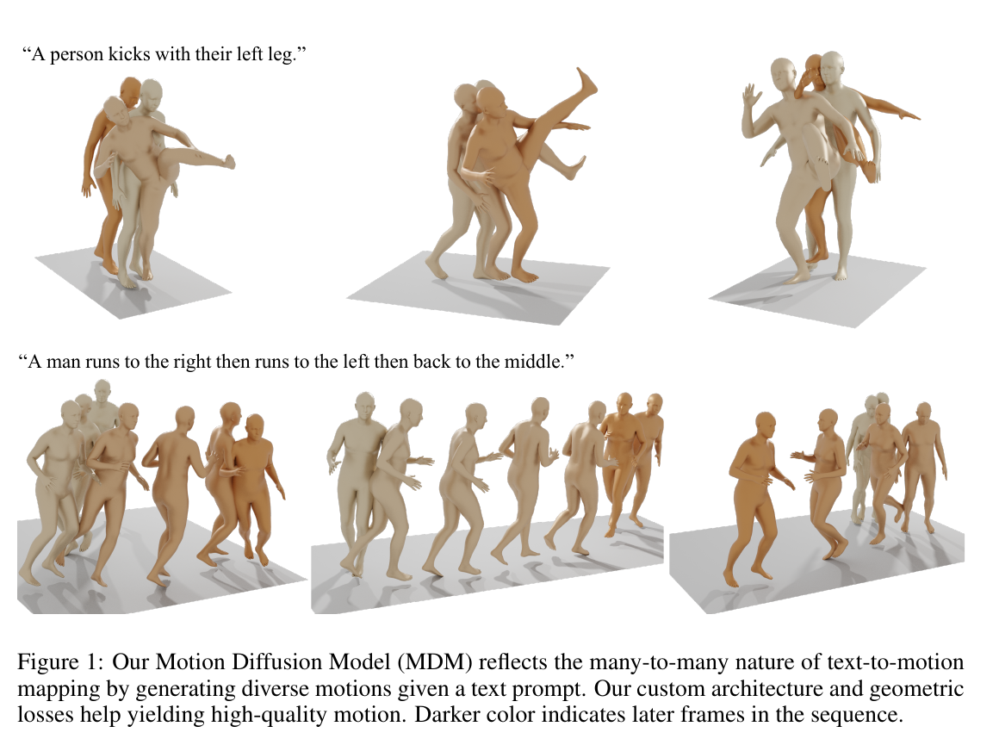
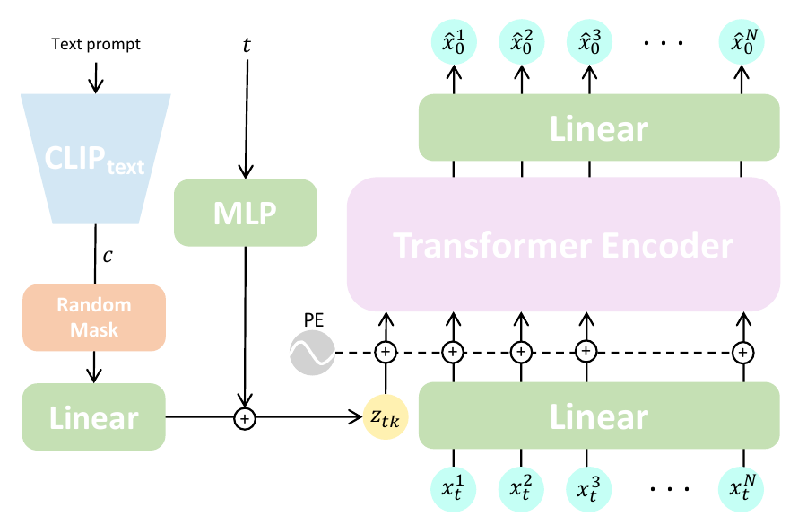
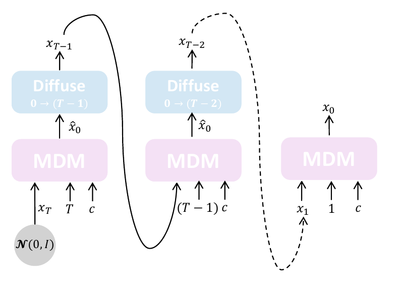

- **论文地址**：[https://arxiv.org/abs/2209.14916](https://arxiv.org/abs/2209.14916)
- **开源代码**：[https://github.com/GuyTevet/motion-diffusion-model](https://github.com/GuyTevet/motion-diffusion-model)

## 1.一句话总结

MDM 是一种基于扩散模型的人体动作生成方法，使用 Transformer Encoder 直接预测完整的干净动作序列，并结合几何损失、Classifier-Free Guidance 和扩散修复技术，实现可控的人体动作生成与编辑。

## 2.研究背景与动机

### 人体动作生成挑战：

1. **动作多样性**：人体可能执行的动作种类繁多，同一种语义描述可能对应多种不同的动作。
2. **数据获取困难**：高质量人体动作数据的采集成本较高。
3. **文本与动作的多对多关系**：同一个文本描述可能对应不同动作，而同一个动作也可以使用多种文本进行描述。例如，“kick”既可能指足球踢球，也可能指空手道踢腿。
### 研究动机：

文本到动作生成是一个**多对多映射问题**，即同一文本可以对应多种合理动作。现有基于 AE 或 VAE 的方法虽然取得了一定成果，但对生成分布存在一定限制。

**扩散模型**无需对目标分布作出特定假设，更适合建模复杂的多对多映射关系，但存在**计算成本高、可控性差**的问题。

因此，本文提出 **Motion Diffusion Model（MDM）**，旨在发挥扩散模型生成质量高、多样性强的优势，同时降低计算开销并提高可控性。

## 3.任务

### 3.1 文本到动作生成（Text-to-Motion）

- **输入**：一段自然语言描述和目标动作长度。
- **输出**：与描述相符的一段三维人体动作。同一句描述可以采样出多种不同但合理的动作。

### 3.2 动作类别到动作生成（Action-to-Motion）

- **输入**：一个离散的动作类别（如某个动作标签）和目标动作长度。
- **输出**：属于该类别、同时具有自然变化的人体动作序列。

### 3.3 无条件动作生成（Unconditioned Generation）

- **输入**：不提供文本描述或动作类别，只指定动作长度，并从随机噪声开始采样。
- **输出**：一段不受语义标签约束的人体动作序列。

## 4. 动作扩散模型（Motion Diffusion Model）

MDM 的目标是根据条件 $c$（文本、动作类别等，无条件动作生成表示为空条件  $c=\varnothing$），生成长度为 $N$ 的人体动作序列 $x^{1:N}$。

生成的动作 $x^{1:N}=\{x^i\}_{i=1}^{N}$ 是一个人体姿态序列，每个姿态可以由关节旋转或关节位置表示：
$$
x^i\in\mathbb{R}^{J\times D}
$$
其中，$J$ 表示关节数量，$D$ 表示每个关节的特征维度。

### 4.1 框架

扩散过程通过马尔可夫链逐步向真实动作 $x_0$ 添加高斯噪声，最终得到近似标准正态分布的 $x_T$。

反向过程从随机噪声 $x_T$ 出发，逐步去噪生成符合条件 $c$ 的动作序列。

与传统 DDPM 预测噪声 $\epsilon_t$ 不同，**MDM 直接预测原始动作 $x_0$**：

$$
\hat{x}_0=G(x_t,t,c)
$$

其中，$x_t$ 为第 $t$ 步的加噪动作，$c$ 为生成条件。

### 4.2 损失函数

MDM 使用重建损失和几何损失共同训练：

$$
\mathcal{L} = \mathcal{L}_{simple} + \lambda_{pos}\mathcal{L}_{pos} + \lambda_{vel}\mathcal{L}_{vel} + \lambda_{foot}\mathcal{L}_{foot}
$$

各项作用：

- **重建损失**$\mathcal{L}_{simple}$ ：使预测动作接近真实动作。

$$
\mathcal{L}_{simple}=\mathbb{E}_{x_0\sim q(x_0\mid c),\,t\sim[1,T]}\left[\|x_0-G(x_t,t,c)\|_2^2\right]
$$

- **位置损失** $\mathcal{L}_{pos}$：约束关节位置的准确性。

$$
\mathcal{L}_{pos}=\frac{1}{N}\sum_{i=1}^{N}\|\mathrm{FK}(x_0^i)-\mathrm{FK}(\hat{x}_0^i)\|_2^2
$$

- **速度损失** $\mathcal{L}_{vel}$：约束相邻帧的运动变化。

$$
\mathcal{L}_{vel}=\frac{1}{N-1}\sum_{i=1}^{N-1}\|(x_0^{i+1}-x_0^i)-(\hat{x}_0^{i+1}-\hat{x}_0^i)\|_2^2
$$

- **足部接触损失** $\mathcal{L}_{foot}$：约束触地时足部速度接近零，减少脚滑。

$$
\mathcal{L}_{foot}=\frac{1}{N-1}\sum_{i=1}^{N-1}\|\left(\mathrm{FK}(\hat{x}_0^{i+1})-\mathrm{FK}(\hat{x}_0^i)\right)\cdot f_i\|_2^2
$$

### 4.3 模型架构

MDM 采用 **Encoder-only Transformer** 作为生成网络。

模型处理流程：

1. 将加噪动作序列 $x_t$ 按帧映射为特征 Token，并添加位置编码。
2. 将扩散时间步 $t$ 和生成条件 $c$ 编码后相加，形成条件 Token。
3. 将所有 Token 输入 Transformer Encoder，利用自注意力建模动作序列的时序关系。
4. 将输出映射回动作维度，得到预测的完整动作序列 $\hat{x}_0$。

条件编码方式：

- **文本条件**：使用 CLIP 文本编码器。
- **动作类别**：使用可学习的类别嵌入。

### 4.4 无分类器引导（CFG）

训练时，随机将 **10% 样本的条件置空**，使模型同时学习有条件和无条件生成。

采样时使用 CFG 调整条件引导强度：

$$
G_s(x_t,t,c) = G(x_t,t,\varnothing) + s\left[G(x_t,t,c)-G(x_t,t,\varnothing)\right]
$$

其中，$s$ 为引导系数，用于调节生成动作对条件的遵循程度，并权衡生成质量与多样性。

### 4.5 动作编辑（Editing）

MDM 将扩散模型的 Inpainting 技术应用于人体动作编辑，**无需额外训练**。

主要支持两种编辑方式：

- **时间维度编辑（In-betweening）**：保留已知的起始帧和结束帧，生成中间缺失动作。
- **空间维度编辑**：固定部分身体关节，重新生成其他身体部位的动作。

**实现方式**：在每次去噪迭代中，将预测动作中对应的已知部分替换为原始输入数据，使生成动作满足指定约束。

